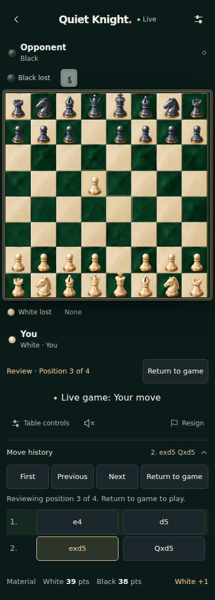
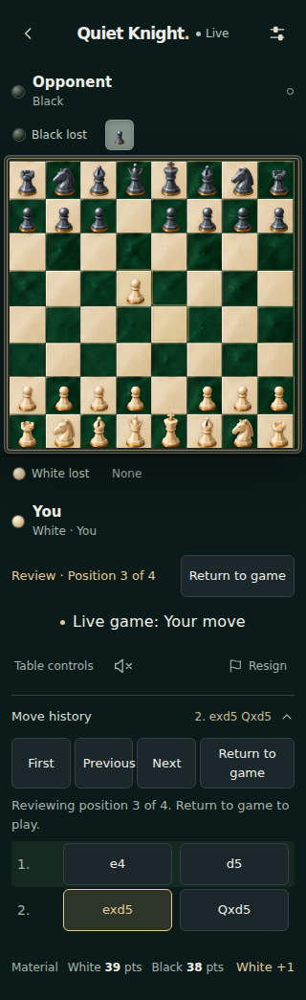
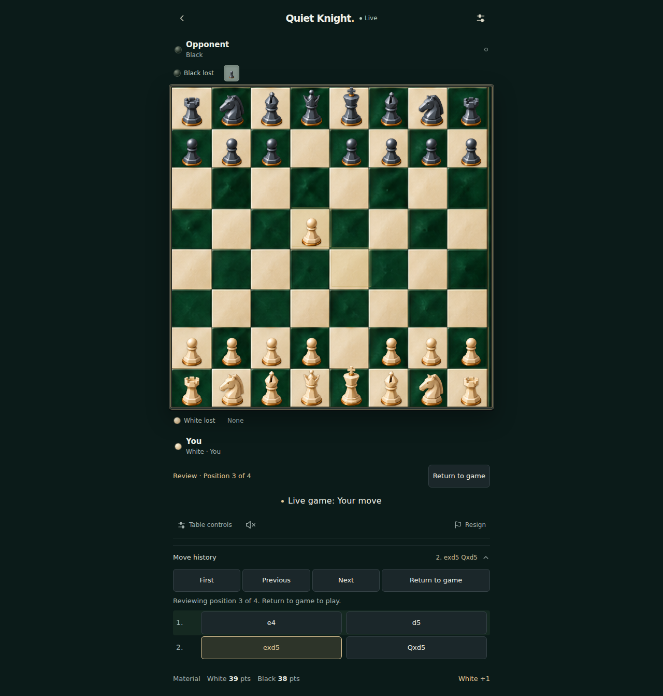
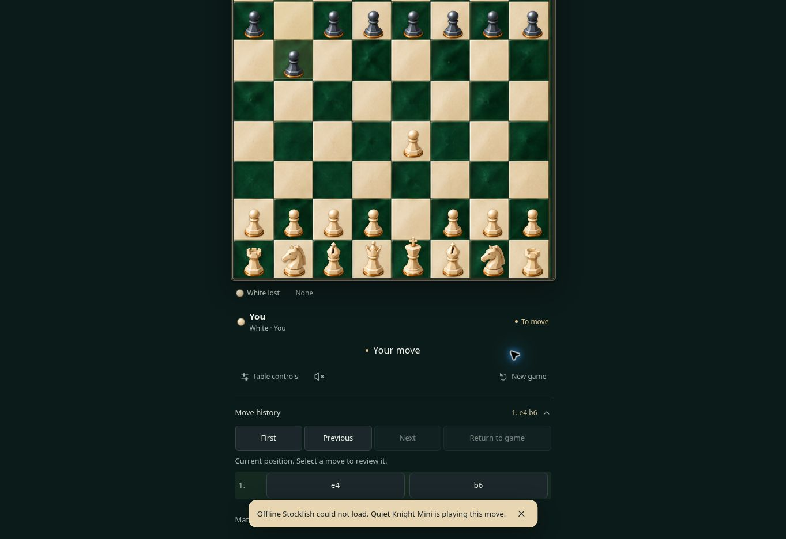

# Captures and move review

Base: `c0fd2afc728fbac2364665eb8c05fdfa7acc06f8` on `codex/quiet-knight-pwa`, matching the production health response observed on 2026-11-02. This preserves the Emerald Enamel artwork and the later install-icon fix.

Each player's lost pieces now appear on that player's side of the board, following board orientation. The visible Move history disclosure supports selecting a move, stepping backward/forward, returning to the starting position and returning to the current game. Historical positions show their own captures, last move and check marker; board input is blocked. Opening review clears pending move confirmation and piece selection. The live game, computer engine, server state and saved moves continue independently.

Appended moves preserve the selected historical position. Takeback, replacement history, a different game or rematch returns the view to the current game. Closing history also returns to the current game. Spectator restrictions remain in effect after leaving review.

## Evidence

- TypeScript and production Vite build passed.
- Deterministic review tests passed for capture ownership, en passant, promotion, castling, checkmate, invalid history, unchanged live position and history boundaries.
- Existing account, local-data, move-archive and asset/reaction tests passed.
- All seven new browser scenarios passed, including offline saved-game preservation and keyboard review with a pending move confirmation.
- Browser interaction tests use the built candidate with synthetic HTTP/WebSocket room fixtures. These verify UI isolation and incoming updates, not the production multiplayer backend.
- Browser screenshots cover 320, 360, 390 and 1280 pixel widths. Equal squares, no horizontal page overflow, 44px controls and the Emerald Enamel theme are asserted.
- The desktop waiting-room viewport regression was fixed by reserving space for the new capture trays; the existing invitation-visibility assertion now passes.
- Existing offline reload, PWA install icons and haptic regression tests passed on the candidate.
- Production app, Postgres and Redis were online when inspected. No backend code, migration, engine logic or production deployment was changed.

Physical Android-device behavior and APK installation were not tested in this pass. No new APK was built in this pass.

## Production publication — 2026-11-02

The owner confirmed deployment in the Railway dashboard after the connector approval control refused the deploy twice. Railway deployment `3894a6b7-9e49-4b99-adca-bf2cfe1cd896` reached SUCCESS at 18:08 São Paulo time. Its source is pinned to `6cc95ebf6e9630e6833ad7052c0d42210ea7eebc`. `/health` returned `ok: true`, this exact commit, identity schema 4 and untimed play. Previous deployment `868af291-f4a3-4474-ad1b-16f5ad2468ec` is the rollback reference.

Actual production-browser check: both loss trays and the visible move-history disclosure rendered. Played e4, received the computer reply b6, selected Previous to show the position after e4 with all board squares disabled, then Return to game restored b6 and enabled normal play.

The cloud browser reported that offline Stockfish could not load and used the existing Quiet Knight Mini fallback for this reply. This is an observed limitation of this check; its cause and physical Android behavior were not verified. No engine change was included in this release.

