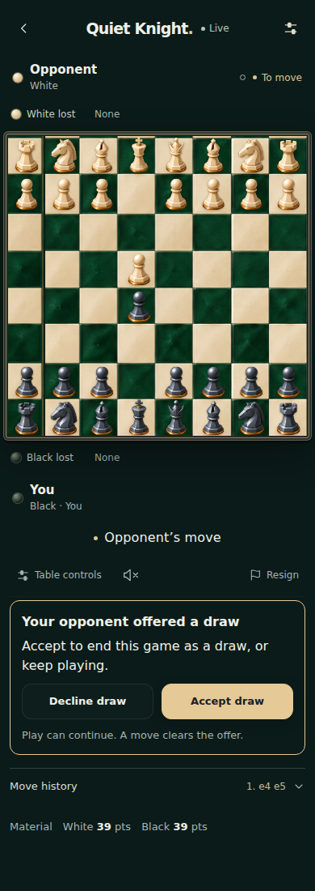

# Visible draw offers

Friend games now show Offer draw directly below the board toolbar. An incoming offer has Accept draw and Decline draw actions; the sender sees Cancel offer. Both sides see explanatory status, without opening Table controls. The server remains authoritative, and an offer only ends the game when the other seat accepts.

The control is absent in computer games, waiting rooms, spectator views and finished games. Busy, disconnected and paused states disable actions. A pending takeback prevents a second proposal; takeback controls remain in the existing table sheet. The existing server rule clears an offer after a move.

## Validation

- TypeScript, production frontend build and backend consent tests passed.
- 11 browser tests passed: 4 draw-offer scenarios plus 7 existing capture/history regressions.
- Draw scenarios use separate browser contexts with synthetic HTTP/WebSocket transport and the production consentTransition function. They cover cancel, decline, accept, opponent reload, spectators, paused/waiting/finished states, pending takeback, disconnect/reconnect and a stale acceptance rejected by the server state machine.
- 320, 390 and 1280px rendered layouts retain 64 equal squares, do not overflow horizontally, and have response buttons at least 44px high. Mobile screenshots were visually inspected.
- Existing real-server studio draw test updated to use the visible controls; it was not run locally. No production test rooms, database changes, engine changes, APK or physical-phone testing.
- This draw-control addition has NOT been deployed. Its parent 898f7c0 (larger symmetric pieces) is live.

