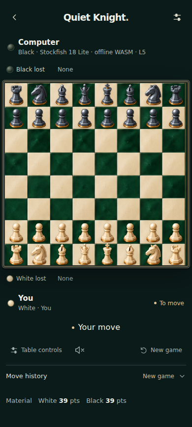
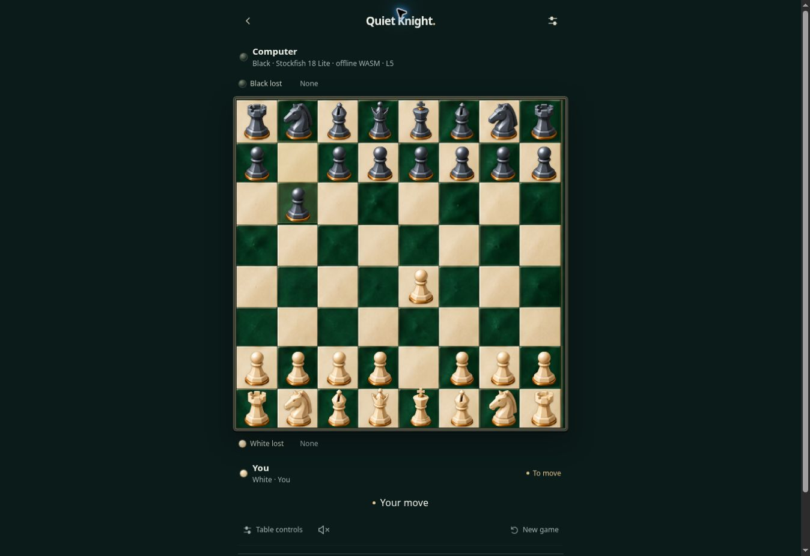

# Larger, balanced board pieces

The user requested larger pieces while preserving symmetry, using the published Emerald Enamel board screenshot as the reference.

Board SVG viewBoxes now fit each model's actual silhouette instead of its 400px atlas cell. Both armies use the same per-role height and a common baseline at 98% of the square. Square viewBoxes preserve each model's proportions and horizontal centering. Artwork pixels, board dimensions, and capture/promotion icons are unchanged.

Pawns occupy 84% of square height (about 20% taller than before); rooks 88% (about 19–20% taller); knights 90%; bishops 92%; queens 94%; kings 96%. Kings previously reached or slightly crossed the square edge, so their size is capped rather than enlarged beyond it. Selected-piece lift is limited to 1% and remains disabled for reduced motion.

## Verification

- TypeScript and production Vite build passed.
- Four relevant browser tests passed: responsive Emerald Enamel table, saved-game/style preservation, offline atlas reload, and the new silhouette geometry check.
- Real SVG silhouette bounds were checked at 320, 390 and 1280 pixels in both orientations: 32 pieces, matching white/black heights and baselines, horizontal centering, no piece overflow, equal 8x8 cells, no horizontal page overflow.
- Legal destination selection and selected-king bounds were checked; reduced-motion selection has no transform.
- Rendered mobile screenshots were visually inspected.
- No physical Android-device test or new APK. Published after user approval on 2 November 2026. Railway deployment d2e9ac3f-ebd3-4ba8-b646-dfe2cac72326 succeeded; /health returned commit 898f7c0f6a788996233eea9d56119b423a80495a. Live browser inspection confirmed the fitted piece viewboxes and centered, enlarged artwork. Previous deployment 3894a6b7-9e49-4b99-adca-bf2cfe1cd896 remains available for rollback.

