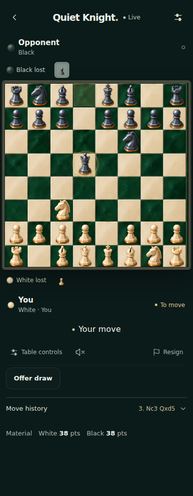

# Playful piece effects

Implements the ten requested animation ideas while retaining the Emerald Enamel board and original piece atlas.

| Idea | Implemented behavior |
| --- | --- |
| Capture attack | Short approach/strike; captured artwork separates into three fading fragments. |
| Knight leap | Arced hop with a small landing dust puff, also on non-captures. |
| Rook charge | Direct charge followed by a small recoil and impact sparks. |
| Bishop slash | Diagonal light streak and brief striking motion. |
| Queen shockwave | Expanding gold ring around the capture square. |
| Pawn bravery | Shoulder-bash motion on a capture, including larger opposing pieces. |
| Promotion | Pawn fades upward into a swirl while the selected promoted piece appears. Underpromotion uses the actual selected piece. |
| King in danger | A brief wobble when a newly accepted move gives check. |
| Castling | Coordinated king and rook travel. Chess960 supports a stationary rook without inventing a rook move. |
| Victory bow | Winning king bows and losing king briefly tips; no repeated effect on reload or history review. |

## Behavior and limits

The Playful piece effects preference defaults on for the requested feature and is saved on this device. Move animations must also be on. Quiet Mode and the device reduced-motion preference suppress the decorative effects. There are no new sounds or downloads.

Effects are derived from already accepted positions. They never validate, delay or submit a chess move. All overlays ignore pointer input. Independent fast replies can overlap visually (at most three transient effects); moves touching the same squares replace stale effects. Decorative nodes expire within 950ms, and individual CSS animations last 260–900ms. Review, position replacement, flipping, unmounting and backgrounding clear presentation state. Server protocol, engine behavior, clocks and stored chess moves are unchanged.

Main friend/computer games and local studio play use the same effects. Historical and export boards remain static.

## Evidence

- TypeScript and production frontend build passed.
- Deterministic metadata tests passed: en passant, all four capture promotions, both standard castles, Chess960 stationary rook, and quiet knight moves.
- 15 new browser scenarios passed across focused runs, covering every capture type, both orientations, special moves, check/victory, settings persistence, suppression modes, rapid moves and history/reload boundaries.
- 15 existing browser regressions passed: draw controls, captures/history, responsive Emerald Enamel layout, offline atlas, and larger-piece silhouette symmetry.
- Mobile render evidence was inspected, including actual short video playback frames. Captures retain equal squares at 320/390px; existing board regression checks include 1280px.
- The live-board browser scenario uses synthetic HTTP/WebSocket transport. No production games were created or changed. No physical Android-device test or new APK.

## Release status

Not deployed. Based on draft PR #23 (visible draw controls), which is also awaiting publication approval. The currently verified live version is 898f7c0 (larger symmetric pieces). Publish this branch only after approval; it includes the preceding draw controls. Railway rollback target: d2e9ac3f-ebd3-4ba8-b646-dfe2cac72326.

[Short rendered animation preview](animation-preview.mp4)

